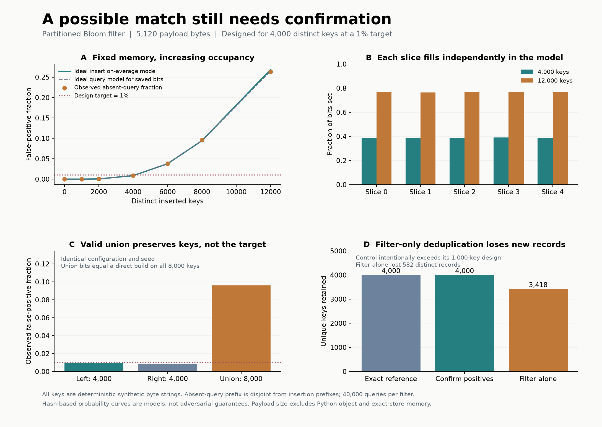

# Bloom Membership Contracts

[](https://github.com/lcx0731/bloom-membership-contracts/actions/workflows/ci.yml)

**A Bloom filter can rule out membership, but a positive answer needs
confirmation when dropping a record would lose data.** This project implements
a partitioned Bloom filter with compatible OR-unions, a portable binary format,
strict decoding, capacity selection, and a synthetic duplicate-handling audit.

The implementation demonstrates data-structure invariants, probabilistic
capacity planning, serialization validation, and integration with an exact
backing store. All example keys are **deterministic synthetic byte strings**.
No private or external data are used. The core package uses only the Python
standard library; plotting and tests have separate dependencies.



## Reproduce

Python 3.11 or newer; CI validates Python 3.11 and 3.13. The committed example
was generated locally with Python 3.13.

```bash
git clone https://github.com/lcx0731/bloom-membership-contracts.git
cd bloom-membership-contracts
python3 -m venv .venv
source .venv/bin/activate
python -m pip install -r requirements.txt
python -m pip install --no-deps .
python -m pip check
python -m pytest -q
python examples/demo.py --output results
bloom-audit --items 4000 --queries 20000 --target 0.01 --seed 1729
```

The example writes [metrics.json](results/metrics.json), the figure above, and a
[synthetic union filter](results/union_filter.pbf). Use `--output /tmp/bloom-results`
to preserve committed outputs. The CLI uses synthetic keys and prints one
capacity audit as JSON. It does not read user files. There is no runtime network
access. Direct test/plot dependencies are pinned; pip resolves their transitive
dependencies for the chosen Python version.

## Membership and lifecycle

A configuration has $k$ disjoint slices of $w=2^p$ bits. Inserting a key sets one
bit in each slice. Querying returns `False` if any required bit is unset, and
`True` if all are set.

- An inserted key has no false negative while its bits and configuration are
  preserved. This deterministic property does not require uniform hashes.
- `True` means **possibly present**. Collisions can make an absent key positive.
- Repeated insertions are idempotent. The filter does not store a unique-key
  count; the capacity model takes the number of distinct keys as an input.
- Compatible union is a bitwise OR that returns a new filter. Power, slice count,
  seed, and implementation format must agree. Union is associative, commutative,
  and idempotent and equals rebuilding on the union of inserted key sets.
- Merging can exceed the planned distinct-key capacity and increase false
  positives. There is no automatic resizing or deletion operation.

```python
from bloom_contracts import BloomFilter, choose_config

config = choose_config(distinct_items=4000, target=0.01, seed=1729)
left, right = BloomFilter(config), BloomFilter(config)
left.add(b"event:42")
right.add(b"event:99")
merged = left.union(right)
restored = BloomFilter.from_bytes(merged.to_bytes())
assert restored.might_contain(b"event:42")
assert restored.might_contain(b"event:99")
```

Keys are bytes, including empty bytes, with a maximum length of 4,096. Text callers
must choose an encoding explicitly, such as UTF-8. Python's randomized `hash()`
is not used. Each slice uses BLAKE2b with an explicit slice index, seed, and key
length. A power-of-two mask maps the digest to a bit position without modulo bias
under an ideal uniform-digest model.

## Two probability models

For $n$ distinct inserted keys and ideal independent uniform hashes, the
insertion-average false-positive probability is

$$p_{\mathrm{design}}=\left[1-(1-1/w)^n\right]^k.$$

The implementation uses `log1p`/`expm1` to evaluate the occupancy term. For a
fixed layout with $b_j$ set bits in slice $j$, a fresh query with independent
uniform slice positions instead has probability

$$p_{\mathrm{layout}}=\prod_{j=1}^k b_j/w.$$

These describe different conditioning: the first averages over insertion
layouts; the second uses observed occupancies. Both depend on ideal hash
assumptions. A fixed BLAKE2-based workload is deterministic, and neither formula
is a worst-case bound for arbitrary or adaptive queries. Repeating one known
false-positive key can produce a 100% observed false-positive fraction.

The reference material is the partitioned-filter discussion in
[Kirsch, Mitzenmacher and Varghese, *Hash-Based Techniques for High-Speed Packet Processing*, Section 2.1](https://www.eecs.harvard.edu/~michaelm/postscripts/dimacs-chapter-08.pdf).
The design and byte format here are an original educational implementation of
established ideas. It does not claim that partitioned filters outperform all
standard or learned Bloom variants.

`choose_config` enumerates powers 4–20 and slice counts 1–16. It selects the
smallest bit payload whose model probability is at most the target; ties prefer
fewer hashes. This is optimal only within that supported discrete family under
the stated model, not over all filter designs or actual query workloads.

## Saved experiment

Planning for 4,000 distinct keys with a 1% target chooses five slices of 8,192
bits: **5,120 payload bytes**, or **5,166 serialized bytes** including metadata
and checksum. The configuration and public seed 1729 are fixed throughout the
capacity experiment. Inserted keys are `insert:0`, `insert:1`, and so on; all
40,000 queried keys have the disjoint `absent:` prefix.

| Distinct inserted keys | Ideal insertion-average FPR | Observed false positives / 40,000 | Observed fraction |
| ---: | ---: | ---: | ---: |
| 0 | 0 | 0 | 0 |
| 1,000 | 0.000020 | 1 | 0.000025 |
| 2,000 | 0.000477 | 24 | 0.000600 |
| 4,000 | 0.008607 | 364 | 0.009100 |
| 6,000 | 0.037757 | 1,520 | 0.038000 |
| 8,000 | 0.094167 | 3,843 | 0.096075 |
| 12,000 | 0.268762 | 10,527 | 0.263175 |

All inserted keys are rechecked at each checkpoint: zero false negatives.
Observed fractions describe this particular workload; no confidence interval
or distribution-free accuracy claim is attached. Prefixes certify absence
without needing a set lookup. Reusing the same absent queries across checkpoints
makes the observations dependent across those checkpoints.

Two disjoint 4,000-key filters have observed false-positive fractions 0.009100
and 0.008500. Their compatible union has fraction **0.096075**. Its bytes exactly
match a direct 8,000-key build. The example writes and reloads that union and
checks membership for every inserted key. The payload remains 5,120 bytes;
Python object overhead, temporary buffers, input keys, and backing-store memory
are not included in this number.

### Duplicate handling

A separate control intentionally uses a 1,000-key design for 4,000 distinct
`event:` keys and 1,334 repeats, processed sequentially:

| Strategy | Distinct keys retained | New keys lost |
| --- | ---: | ---: |
| Exact reference | 4,000 | 0 |
| Bloom precheck + exact confirmation | 4,000 | 0 |
| Bloom filter alone | 3,418 | **582** |

The confirmed strategy skips an exact membership lookup for Bloom negatives.
For positives, it queries the exact store before deciding to drop a duplicate.
It performs 1,916 exact membership lookups and avoids 3,418, compared with one
lookup for each of the 5,334 input events. It still writes and retains all 4,000
accepted keys in the exact store. This is an operation-count example; it does
not measure latency, claim total-memory savings, or implement a remote database.

The demonstration begins with both stores empty and updates them together in
one sequential pass. A stale filter missing keys already in a real backing
store would violate that invariant. Concurrency, crashes, and cross-store
transactions require additional system design and are outside this project.

## Portable format

All integers are unsigned and little-endian; the format contains no timestamps
or insertion counts.

| Field | Bytes |
| --- | ---: |
| Magic/version `PBF1` | 4 |
| Power $p$ | 1 |
| Number of slices $k$ | 1 |
| Public seed | 8 |
| Slice-major bit payload | $k2^p/8$ |
| SHA-256 of all preceding bytes | 32 |

Within a payload byte, slot remainder zero is the least significant bit. Slice
$j$ hashes the concatenation of the 8-byte seed, 1-byte slice index, 2-byte key
length, and key. It uses `hashlib.blake2b`, digest size 8, personalization
`PBloomSlot-v1`; the digest is interpreted little-endian and masked by $2^p-1$.
See the [Python hashlib documentation](https://docs.python.org/3/library/hashlib.html).

The decoder checks the total size, version, parameter bounds, exact payload
length, and checksum before constructing the filter. It rejects trailing data,
truncation, unsupported versions, and mismatched checksums. Maximum payload is
2,097,152 bytes. The caller already owns the input byte buffer; this is a bounded
decoder, not a streaming file reader.

The checksum detects accidental corruption. It does **not** authenticate who
wrote the filter or prove which keys were inserted: someone can change the bits
and recompute it. Tests include that limitation. Persistence preserves the
no-false-negative property only when the correct configuration and insertion
bits survive. The example's file write is not a transactional durability API.

## Validation and scope

The **18 tests** check an independent set-of-positions oracle for bit packing,
empty and duplicate insertion, OR-union laws and rebuild equivalence, mismatched
configurations, exact enumeration of a small ideal-hash model, minimal supported
capacity selection, safe versus unsafe deduplication, all truncation points and
single-bit corruptions of a small encoded filter, byte-format portability,
cross-process membership, invalid inputs, and the installed CLI. Tests use a
broad fixed-workload false-positive sanity check rather than requiring an
observed rate to equal the theoretical value.

| Path | Purpose |
| --- | --- |
| `src/bloom_contracts/core.py` | Filter, capacity search, union, binary encoding |
| `src/bloom_contracts/audit.py` | Synthetic workloads and duplicate-handling controls |
| `src/bloom_contracts/cli.py` | Reproducible audit command |
| `examples/demo.py` | Capacity, union, persistence and loss experiments |
| `tests/` | Contract checks and independent references |
| `results/` | Synthetic metrics, figure, and serialized filter |

Config values are built-in Python integers; seeds span unsigned 64-bit values.
Capacity planning supports up to two million distinct keys and target values
from `1e-9` to `0.5`, and raises if no supported design is feasible. The CLI
caps insertion work at 50,000 keys and absent queries at 200,000. Filters do not
support deletion, counting, resizing, automatic capacity enforcement, or
concurrent mutation. A full filter remains valid but can answer positive for
every key. No adversarial robustness or production throughput is claimed.

Released under the [MIT License](LICENSE).
